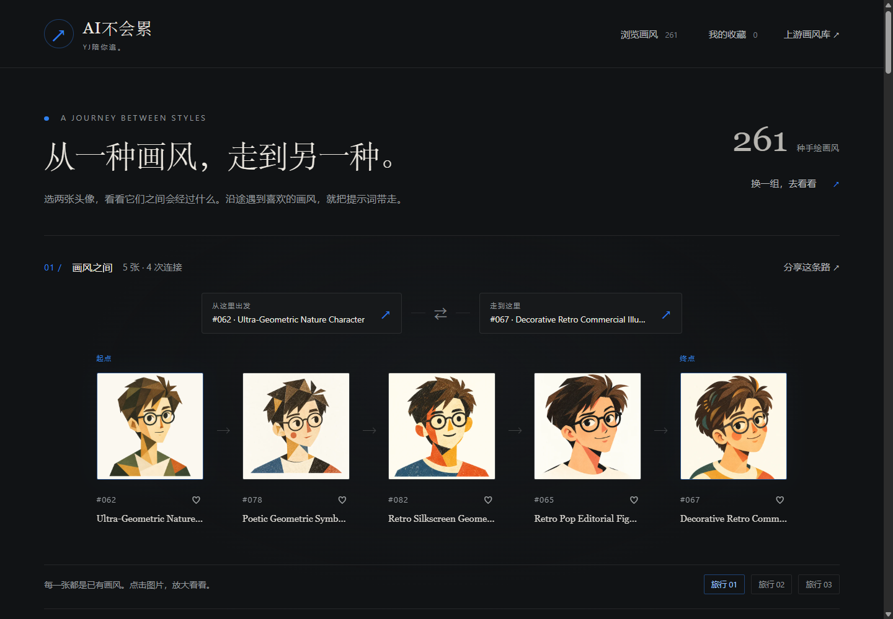

# 画风之间

选两张头像，沿着一条由已有画风组成的视觉路径探索。发现喜欢的画风后，填写自己的主题，复制或下载上游规则输出的中英文提示词。

这是 **AI不会累 / YJ** 的一个开源实践。默认附带261种画风的同人物头像，普通使用者无需配置API Key；开发者可以替换自己的图片与文字资料，重新构建连接。



## 能做什么

- 查看示例路线，或从完整图库选择两个端点；点击和桌面拖拽均可选图。
- 浏览沿途头像、放大详情、将任意头像设为新的起点或终点。
- 按编号、名称或资料关键词搜索；按分类浏览。
- 收藏画风，保存在当前浏览器；分享带数据版本的路线链接。
- 复制上游模板，或填主题后复制／下载TXT；另行下载风格参考图。
- 使用深色画廊，适配窄屏、键盘及减少动态效果偏好。

中间图片是现有画风，不是两端融合生成的图片，也不是“左边线条＋右边配色”的最佳匹配。路线基于模型视觉特征，可能受到背景、人物结构和色彩影响；无合适连接时允许没有路径。它不表示艺术史、作者关系或审美排名。

## 本地打开

需要一个静态服务器，**不要直接双击 index.html**，浏览器对本地文件的JSON读取可能有限制。

```bash
python -m http.server 5190 --bind 127.0.0.1
```

打开 http://127.0.0.1:5190/ 。Windows也可以运行 `start-preview.ps1`。

网页不依赖Python：Python只在这里用于提供静态文件；可以换用任何静态服务器。正式部署时不需要推理服务、密钥或模型权重。

## 在线部署

将 `index.html`、`styles.css`、`app.mjs`、`core.mjs`、`favicon.svg`、`data/`、`assets/` 和许可文件发布到静态托管。所有网页资源使用相对路径，支持仓库子路径部署。使用HTTPS可获得完整剪贴板体验；剪贴板不可用时页面会选中文字供手动复制。

GitHub Pages可发布独立仓库；可运行 `python scripts/package.py` 生成仅包含站点文件的部署包。不要发布 `.runtime/`、本地规划文件、模型权重或私有配置。本仓库附带 `.nojekyll`。

## 提示词来源

默认资料固定于 [yang0/handraw-style 的261条快照](https://github.com/yang0/handraw-style/tree/58dee6151874c6fc381e6a0d97430f1c275c1696)，避免旧头像与新编号错配。

提示词移植该版本确定性模板：风格名称、主题、参考作者／风格名称，以及使用者明确填写的可选约束。它是按上游规则输出的提示词，**不是每张头像的原始生图记录**。

中英文模板中的用户主题保持原文，英文模板不会自动翻译中文主题。普通模板不自动增加traits，不自动融合两端。参考图与上传说明独立提供，最终生成效果由使用者所用工具决定。

## 视觉路径怎么构建

1. 固定图片与资料版本，记录文件SHA-256。
2. 开发阶段提取图像特征。默认图由DINOv2 ViT-S/14构建；OpenCLIP和颜色／边缘统计保留作对照。
3. 归一化后计算余弦距离。每张图连接5个近邻，双向取并集，再移除距离超出候选边90%分位数的连接。
4. 网页使用非负边权的Dijkstra寻路，固定编号打破等价路径的平局。

第一版图有917条无向连接、11个孤立节点；固定16组测试配对中14组存在路径。**可达数量不是匹配准确率**。模型选择是本素材库的初步目视判断，不是普遍画风评测结论。

已保留[对照页面](research/index.html)、[实验记录](research/REPORT.md)与原始对照数据。部分相邻连接仍不够自然；没有读者研究或生图复现效果验证。

## 替换素材与重建

输入目录包含 `styles.json`，顶层结构为 `{ "styles": [...] }`，每条至少：

```json
{
  "id": "001",
  "name": "画风名称",
  "author": "参考作者或画风标签",
  "group": "分类",
  "traits": "用于展示的特征原文",
  "avatar_url": "assets/avatars/001.webp",
  "preview_url": "assets/previews/001.webp"
}
```

图片与资料只使用你有权分发的内容。替换后更新来源、许可及模板定义，不应保留本默认库的上游归属而造成误导。

```bash
python scripts/prepare.py --source ./input
```

随后按[重建指南](REBUILD.md)准备开发环境、明确下载模型、提取特征并建图。完整模型分析在构建阶段完成，读者浏览时不需要下载模型。

## 验证

```bash
node tests/core.test.mjs
python scripts/verify.py
python tests/rebuild_smoke.py
```

验证路径边界与平局、上游模板一致性、分享链接不包含主题、资料版本和资产哈希。浏览器检查记录见 [VERIFICATION.md](VERIFICATION.md)。

替换库冒烟检查在忽略的.runtime目录中运行，不覆盖附带资料；已验证1张和3张的小库可重建。

## 许可与致谢

- 原创代码和文档：[MIT](LICENSE)。
- YJ有权授权的头像部分：[CC BY 4.0](ASSET_LICENSE.md)。
- 上游资料、参考图和模型：[第三方说明](THIRD_PARTY_NOTICES.md)。

感谢 **yang0 / handraw-style** 提供画风资料和提示词规则。交互灵感来自 Google Arts & Culture 的 X Degrees of Separation。保留各自许可与来源，不将本项目MIT许可套用到所有第三方资产。
